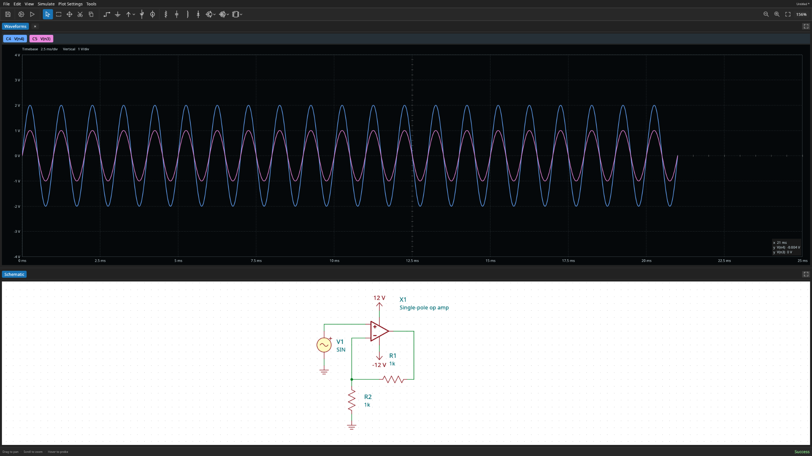

# OpenSpice

OpenSpice is a native Rust circuit simulator with an editable SPICE netlist and transient waveforms, AC magnitude plots and DC operating-point results. It uses eframe/egui for the desktop window and runs the ngspice batch executable in a background thread.

I started OpenSpice as an engineering student to make experimenting with circuits easier, more intuitive, and more fun. OpenSpice was built entirely with AI. It is an educational project and is not intended to replace an industrial circuit simulator.

**Work in progress.** Expect bugs, incomplete features, and changes as the project develops.

## Download

Get the x86-64 builds from [GitHub Releases](https://github.com/Jockkoo/OpenSpice/releases). Open a release and look under **Assets** for the package for your platform.

- **Arch Linux:** Download the `.pkg.tar.zst` file and install it from your downloads directory with `sudo pacman -U ./openspice-0.1.0-1-x86_64.pkg.tar.zst`. Substitute the filename you downloaded if the version differs. Launch OpenSpice from your application menu or run `openspice`.
- **Windows:** Download the Windows ZIP and extract it completely. Run `OpenSpice.exe` and keep the bundled `Spice64` folder beside it so simulations can find ngspice.

## Screenshots

**RLC filter.** The schematic and its damped pulse response.


**Op amp circuit.** A non-inverting amplifier with input and output waveforms displayed together.



## Build from source on Arch Linux

Install the build tools, Rust toolchain, simulator, and desktop libraries. An existing current stable Rust toolchain also works in place of the Arch `rust` package.

```sh
sudo pacman -S --needed base-devel rust ngspice libx11 libxkbcommon wayland libglvnd
cargo run --locked
```

Run the Cargo command from this project directory in your Wayland or X11 desktop session.

## Verify

```sh
cargo fmt --check
cargo clippy --all-targets -- -D warnings
cargo test
cargo test rc_time_constant -- --ignored --nocapture
```

The last command exercises the actual ngspice executable and checks the simulated RC step response against the analytical value.
