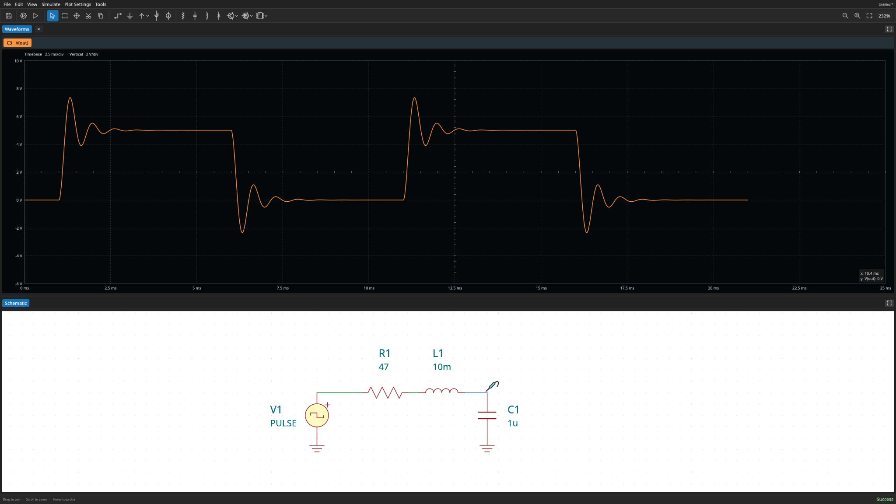

# OpenSpice

OpenSpice is a native Rust circuit simulator with an editable SPICE netlist and transient waveforms, AC magnitude plots and DC operating-point results. It uses eframe/egui for the desktop window and runs the ngspice batch executable in a background thread.

I started OpenSpice as an engineering student because I wanted a simulator for my coursework and circuit experiments. OpenSpice itself was made entirely with AI. It is for educational use only and is not intended to replace an industrial circuit simulator.

**Work in progress.** Expect bugs, incomplete features, and changes as the project develops.

## Download

Get the x86-64 builds from [GitHub Releases](https://github.com/Jockkoo/OpenSpice/releases). Open a release and look under **Assets** for the package for your platform.

- **Arch Linux:** Download the `.pkg.tar.zst` file and install it from your downloads directory with `sudo pacman -U ./openspice-0.1.0-1-x86_64.pkg.tar.zst`. Substitute the filename you downloaded if the version differs. Launch OpenSpice from your application menu or run `openspice`.
- **Windows:** Download the Windows ZIP and extract it completely. Run `OpenSpice.exe` and keep the bundled `Spice64` folder beside it so simulations can find ngspice.

## Screenshots

**RLC filter.** The schematic and its damped pulse response.



**Op amp circuit.** A non-inverting amplifier with input and output waveforms displayed together.


## Build from source on Arch Linux

Install the build tools, Rust toolchain, simulator, and desktop libraries. An existing current stable Rust toolchain also works in place of the Arch `rust` package.

```sh
sudo pacman -S --needed base-devel rust ngspice libx11 libxkbcommon wayland libglvnd
cargo run --locked
```

Run the Cargo command from this project directory in your Wayland or X11 desktop session.

## Inspect the RLC example

1. Launch OpenSpice. The schematic opens with [the bundled example](examples/rlc-low-pass.cir). **Load Example** restores the example.
2. Click **Run Simulation**. The 0–5 V pulse drives a 47 Ω resistor and 10 mH inductor in series with a 1 µF capacitor to ground. Probe V(out) to see overshoot and damped ringing at each edge.
3. In Cursor mode, click a wire or junction to show its node voltage, or click a component to show its branch current. Double-click a probe target to show only that signal. Rerun after editing the circuit to probe the updated results.
4. To remove a trace, hover over its line and press **Delete**, or click its legend entry. Scroll to zoom both axes, Ctrl+scroll to zoom horizontally, or Ctrl+Shift+scroll to zoom vertically. Left-drag to zoom to a box and middle-drag to pan. Right-click and choose **Zoom to Fit** to fit the visible traces.
5. Right-click V1 in Cursor mode to choose a different source type and set its parameters. Apply the change and run again. Open **ngspice output** to inspect stdout and stderr. The pane opens automatically on failure.

Use **Configure Simulation** to choose transient, AC, or DC operating point, then **Run** to simulate. For AC analysis set the small-signal magnitude and optional phase in the voltage source properties.

**File → Save** (Ctrl+S) and **Save As…** (Ctrl+Shift+S) write a SPICE netlist with an OpenSpice layout comment. **File → Open…** restores the layout or imports a plain netlist. An asterisk beside the filename indicates unsaved edits.

Use a self-contained netlist with a title on the first line, one analysis directive, and `.end`. Each run uses a fresh temporary working directory. Probed voltage and current traces appear in the legend.

## Verify

```sh
cargo fmt --check
cargo clippy --all-targets -- -D warnings
cargo test
cargo test rc_time_constant -- --ignored --nocapture
```

The last command exercises the actual ngspice executable and checks the simulated RC step response against the analytical value.

## Place a component

Drag a component icon onto the schematic, or open the op-amp-shaped component picker, choose a part and click to place it. Components use their default value at placement. Double-click the placed component in Cursor mode to edit its value. Use **Wire** to click a starting point, then click to commit each section and continue from its endpoint. Routing along both pins of a component inserts it in series. Press **Esc** or right-click to finish. Ending a wire on another segment creates a junction. The wire tool highlights new junctions before you click. Place **Ground** on a pin or wire to connect it to SPICE node 0. The upward **VCC** power symbol connects its pin to the shared VCC net. Dragging a connected part or supply symbol extends a wire back to its original junction. **Select** supports clicking, box selection, and Shift-click to toggle individual objects. With **Move**, click a component to pick it up and click again to place it. Its wires stay where they are. Escape cancels the move. With **Delete**, click an object to remove it, or drag a box to delete the selection when you release the mouse. Press **Ctrl+R** to rotate the placement preview or selected components clockwise by 90°. Scroll over the schematic to zoom around the pointer and drag with the middle mouse button to pan. Press **Esc** to return to Cursor.

The schematic reflects top-level R, C, L, V, and I elements in the netlist. Edit a component’s line to change its value or terminals, or remove the line to delete it. **Run Simulation** uses the edited circuit and opens the waveform above the schematic by default. Under **Plot Settings → Waveform layout**, choose **Vertical split** (waveform above), **Horizontal split** (waveform on the right), or **New tab**. OpenSpice remembers this setting between sessions. Drag a tab to the workspace edge to dock it, or drop it in the center to group the tabs. Drag the divider to resize the panes, or use **Maximize** and **Restore**.
